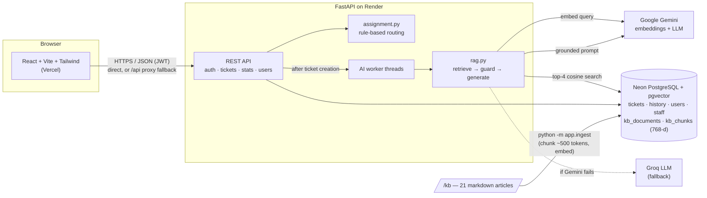

# GroundDesk: Smart Help Desk Ticketing System for IT Services

A college mini-project: an IT help desk where employees raise tickets, an AI suggests troubleshooting steps **grounded in a knowledge base** (RAG), and anything the AI cannot solve is routed to the right technician by explainable rules. If the knowledge base has no reliable answer, the system says so instead of guessing.

- **Live app:** https://it-help-desk-rag.vercel.app
- **API docs (Swagger):** https://smart-helpdesk-api-w2mf.onrender.com/docs
- **Progress log:** [`PROGRESS.md`](PROGRESS.md)

> The backend runs on Render's free tier, which sleeps after ~15 minutes idle. The login page shows **Server ready** once it has woken up (up to a minute).

## Features

| Area | What it does |
|---|---|
| **Role-based portals** | Separate **Employee / Technician / Admin** login options. Each email has exactly one account and one role. Employees self-register; staff accounts are seeded. |
| **Tickets** | `HD-0001`-style codes, validation (title 5–120 chars, description ≥ 20, category and priority enums), and a status timeline that records who made every change. |
| **AI suggestions (RAG)** | The ticket is embedded and the 4 most similar knowledge-base chunks are found with pgvector. The LLM writes numbered steps **only from those articles**, citing `[1]`, `[2]`, with High/Medium/Low confidence. |
| **Insufficient-context guard** | If the best match scores below **0.70**, the LLM is never called: the ticket shows "No reliable solution found" and the articles that were checked. |
| **Feedback and routing** | "Yes, it is fixed" → Resolved. "No" → escalated and routed by **category rule → keyword fallback → General IT**, to the **least-loaded** technician. The matched rule is shown. |
| **Technician workflow** | Queue grouped by stage: Start work → **Mark solved** (resolution note required) → the employee **approves or rejects** the closure. Technicians cannot close tickets themselves. |
| **Admin** | Dashboard (status, AI outcome, per department, per category, average time to close); all tickets; change priority/category; reassign; force-close and reopen (reason required); notes; user management. |

**Ticket lifecycle**

```
OPEN → SUGGESTION_PROVIDED → RESOLVED                        (employee: "Yes, it is fixed")
                           → ESCALATED → ASSIGNED             (employee: "No", then automatic routing)
ASSIGNED → IN_PROGRESS → PENDING_APPROVAL → CLOSED             (technician; employee approves)
PENDING_APPROVAL → IN_PROGRESS                                 (employee rejects, with a reason)
```

Out of scope by design (per the project brief): chatbots, agents, email integration, ML-based routing.

## Architecture



- **One backend service** handles tickets, RAG and routing; there are no agents or orchestration frameworks.
- AI suggestions run on a small worker pool **outside** the request cycle, so a slow LLM never holds up other users.
- `llm_client.py` is the only place that talks to AI providers: Gemini first, Groq as fallback (a failing provider is skipped for 10 minutes), plus an offline **mock** mode for tests and demos.
- The browser calls the Render API directly and falls back to `/api` on the Vercel site (forwarded by `frontend/vercel.json`) if the direct call is blocked.

## Tech stack

| Layer | Choice |
|---|---|
| Frontend | React 19, Vite, Tailwind CSS v4, React Router; Vitest + oxlint |
| Backend | Python 3.12, FastAPI, SQLAlchemy 2, Alembic, Pydantic |
| Database | PostgreSQL + pgvector (Neon free tier) |
| AI | Gemini `gemini-embedding-001` (768-d) and `gemini-3.8-flash`; Groq `openai/gpt-oss-120b` fallback |
| Auth | scrypt password hashes (stdlib), role-bound JWT bearer tokens (PyJWT) |
| Tests | pytest + FastAPI TestClient (62 tests), Vitest (10 tests) |
| Hosting | Render (API, free), Vercel (frontend, free) |

## Repository structure

```
backend/
  app/
    main.py            FastAPI app, CORS, JSON 500s, /health (reports deployed commit)
    models.py          SQLAlchemy models (tickets, history, AI suggestions, KB, staff, users)
    routers/           auth, tickets, stats, staff, users
    rag.py             retrieval, insufficient-context guard, grounded prompt
    llm_client.py      embeddings + generation, provider fallback, mock mode
    assignment.py      category/keyword/default routing, least-loaded technician
    ticket_service.py  allowed status transitions, timeline entries
    security.py        password hashing, JWT, role checks
    ingest.py          /kb → chunks → embeddings → pgvector
    seed.py            departments, technicians, demo accounts (+ --reset-demo-passwords)
  alembic/             database migrations
  tests/               pytest suite
frontend/
  src/pages/           Login, Register, TicketList, NewTicket, TicketDetail, TechnicianView, Dashboard, Users
  src/components/      suggestion card, timeline, panels, password field, server status …
  src/api.js           API client (errors, retries, route fallback) + api.test.js
  vercel.json          SPA routing and the /api → Render forward
kb/                    21 troubleshooting articles (front matter: title, category)
render.yaml            Render Blueprint for the backend
```

## Local setup

**Prerequisites:** Python 3.12, Node.js 20+ (developed on 24), a Neon (or Supabase) PostgreSQL database with `CREATE EXTENSION vector;`, and a Gemini API key (Groq optional).

### Backend

```powershell
cd backend
python -m venv .venv
.venv\Scripts\activate                 # macOS/Linux: source .venv/bin/activate
pip install -r requirements-dev.txt
copy .env.example .env                 # then fill it in (see below)
alembic upgrade head                   # create tables
python -m app.seed                     # departments, technicians, demo accounts
python -m app.ingest                   # embed the /kb articles
uvicorn app.main:app --reload --port 8010
```

Swagger UI: http://localhost:8010/docs

### Frontend

```powershell
cd frontend
npm install
copy .env.example .env                 # VITE_API_URL=http://localhost:8010
npm run dev
```

Open http://localhost:5173. If you use another port, add it to `CORS_ORIGINS`.

### Environment variables

Secrets live only in `.env` files, which Git ignores; only `.env.example` files are committed.

| Where | Variable | Purpose |
|---|---|---|
| backend | `DATABASE_URL` | PostgreSQL connection string (pgvector enabled) |
| backend | `CORS_ORIGINS` | Comma-separated allowed frontend origins |
| backend | `GEMINI_API_KEY`, `GROQ_API_KEY` | AI providers (Groq is the fallback) |
| backend | `LLM_PROVIDER`, `EMBEDDING_PROVIDER` | `gemini` (default), `groq`, or `mock` |
| backend | `SIMILARITY_THRESHOLD` | Guard threshold (0.70 with Gemini embeddings; use 0.40 with `mock`) |
| backend | `JWT_SECRET` | Signs login tokens: a long random value |
| backend | `DEMO_PASSWORD` | Password for seeded demo accounts (≥ 8 chars; accounts are not created without it) |
| frontend | `VITE_API_URL` | Backend URL (local: `http://localhost:8010`; production: the Render URL) |

## Testing

```powershell
cd backend;  .venv\Scripts\python -m pytest       # 62 tests; uses a separate <db>_test database
cd frontend; npm test; npm run lint; npm run build # 10 tests
```

The backend tests use mock embeddings and a mocked LLM, so they make no AI API calls. They cover the 10 scenarios from the brief plus auth, roles, the dashboard and the regressions found in production.

## Deployment

**Backend (Render):** a Blueprint from [`render.yaml`](render.yaml). On every start it runs `alembic upgrade head`, `python -m app.seed` and `python -m app.ingest` (only changed articles are re-embedded), then uvicorn. Set `DATABASE_URL`, `CORS_ORIGINS` (the Vercel URL), `GEMINI_API_KEY`, `GROQ_API_KEY`, `JWT_SECRET` and `DEMO_PASSWORD` in the dashboard. Check the deployed version at `/health` (`version` = commit).

**Frontend (Vercel):** import the repo with **Root Directory** `frontend` and set `VITE_API_URL` to the Render URL. `vercel.json` handles client-side routes and the `/api` forward. Vite bakes env vars in at build time, so redeploy after changing them.

## Known limitations

- Free hosting: the API sleeps when idle (first request up to ~1 minute), and the Gemini free quota can run out (Groq takes over automatically).
- No email notifications, attachments, SLAs, or password reset by email (the admin resets passwords).
- Technicians have no individual skills; routing uses departments and current load.
- No ticket deletion in the app; no admin UI to create staff accounts or departments (they come from `app/seed.py`).
- The knowledge base is 21 hand-written articles. Issues outside it (e.g. hardware noise, physical damage) are intentionally escalated rather than answered.
